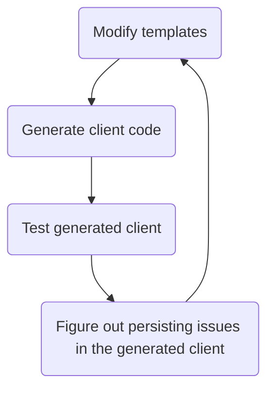

# Workflows

The following are the general workflow for working with the Python client for Osparc's public API. For brevity `clients/python` will be denoted by PYDIR

Run `make install-dev` from PYDIR to setup the development environment.

### The client code
- The Python client is generated by [openapi-generator](https://github.com/ITISFoundation/openapi-generator). This is done via a docker image is used to generate the cliens is specified in `/scripts/common.Makefile`. To generate the client, run `make python-client` from PYDIR. This generates `clients/python/artifacts/client` which contains all generated code.
- You can generate a wheel or a tar ball from this code by then runnign `make dist` from PYDIR. The artifacts will be places in `clients/python/artifacts/dist`

### The documentation
To generate the documentation, run `make docs` from PYDIR. This generates the client in `clients/python/artifacts/client` and postprocesses the documentation placed there.

## Guidelines
Changes to the client should not be performed within the generated python code, but in the templates in [openapi-generator](https://github.com/ITISFoundation/openapi-generator) so the client can be regenerated whenever new routes are added to the osparc public api server.

*Please do not manually `git commit` auto generated code into this repository*

### Supported Python versions
The client supports Python 3.11 up to the newest interpreter in the `test-latest` matrix of `.github/workflows/build-python-client.yml`. The floor is declared by `python_requires` in `setup.py`.

`OPENAPI_GENERATOR_TAG` in `scripts/common.Makefile` pins the generator image. Whatever `requires-python` the generated package declares gets overwritten with `python_requires` from `setup.py` during generation, so the pin never decides the supported floor. Bumping the tag regenerates the client, and the diff has to be reviewed: v7.27.0, for instance, stopped emitting a model per `anyOf` union.

### Interpreter end of life
`clients/python/src/osparc/_python_eol.py` holds the end-of-life date of each supported interpreter. At import it warns when the running interpreter is within three months of that date, or already past it; set `OSPARC_DISABLE_PYTHON_EOL_WARNING=1` to silence the warning.

The dates are a copy of [endoflife.date](https://endoflife.date/python), and a copy drifts: `scripts/check-python-eol-dates.bash --check` compares it against the API and runs in the `lint` workflow, `--write` rewrites it. The table is embedded instead of fetched at import, which would add a network call to every `import osparc`, including on deployments without internet access.

# Testing
Tests are located in `PYDIR/test_osparc` and `PYDIR/test_osparc_client`. They can be run by executing the following commands from PYDIR:
```bash
make install-test
make tests
```
after the client has been generated (see the [workflow section](#workflow)). These tests should test the user-facing API. Jupyter notebooks in the PYDIR/docs folder are automatically run as part of the tests via `test_notebooks.py`. Hence, when writing a tutorial jupyter script, also think of it as a test. For this reason, any import of `osparc` in the notebook should be "guarded" by a `if importlib.util.find_spec('osparc') is None:` statement (see the [BasicTutorial](./docs/BasicTutorial.ipynb))

# Tips
When modifying templates on the [openapi-generator](https://github.com/ITISFoundation/openapi-generator) repository the pace at which you can progress is determined by the speed at which you can loop through the following diagram



Hence, it is important to be able quickly modify the [templates](https://github.com/ITISFoundation/openapi-generator/tree/master/modules/openapi-generator/src/main/resources) and regenerate the client. To do this without rebuilding the docker image containing the openapi-generator, run `make python-client-from-templates path/to/template/dir` from `clients/python`.

## Upcoming Deprecations

`osparc.models` and `osparc.api` modules have been (now) deprecated and will be retired/removed in the next version, please used `osparc` to import all the functions instead


## Client e2e testing

### Running the suite

The suite in `test/e2e` runs against a real deployment. It is plain `pytest`: no wrapper, and
the deployment and credentials come from the environment.

| Variable | Purpose |
| --- | --- |
| `OSPARC_API_HOST` | the deployment's api-server url |
| `OSPARC_API_KEY` | api key of the test user |
| `OSPARC_API_SECRET` | that key's secret |
| `OSPARC_CLIENT_VERSION` | optional label. When set, and neither `latest_release` nor `latest_master`, the run aborts if it differs from the installed `osparc.__version__` |
| `OSPARC_E2E_JOB_LOG` | optional file the notebook tests record the ids of the jobs they create in, for `test/e2e/cleanup_jobs.py` |

```console
source .venv/bin/activate
cd clients/python
make install-e2e-test OSPARC_VERSION=latest_release  # or install-e2e-test-local for this repo
pytest test/e2e --junitxml=artifacts/junit_e2e.xml   # or: make e2e-test
```

`test/e2e/pytest.ini` holds what is constant (asyncio mode, required plugins, verbose output
streamed while tests wait on server-side jobs). `--junitxml` is a caller's choice, so it stays
on the command line. The report header names the client version, the deployment and the
deployment's api-server version before the first test runs.

`make e2e-shell` opens the container the CI uses
([`docker/osparc_python_tutorial_testing`](../../docker/osparc_python_tutorial_testing)) when
you want to run inside it.

Tests delete the jobs they create once they finish. The notebooks cannot: they submit jobs from
inside a kernel no fixture can reach, so the runner prepends a cell that appends every job id it
creates to the file named by `OSPARC_E2E_JOB_LOG` (a per-test temporary file when that is unset),
and a fixture deletes those ids once the notebook is done. Point the variable at a path you keep
when the run may get killed before that teardown, and follow the suite with
`python test/e2e/cleanup_jobs.py --job-log "$OSPARC_E2E_JOB_LOG" --retry-minutes=10` from a step
that runs on failure too. Without a log it deletes nothing and says so; `--all-jobs` deletes
every job of this user on the deployment instead, which also removes jobs a concurrent run is
waiting on.

### Running it in CI

One job runs one client version against one deployment, and the job's status is pytest's own
exit code; decide whether a failure blocks the pipeline with the platform's own
`allow_failure`/`continue-on-error`. Credentials belong in CI secrets, not in this repository.

GitLab:

```yaml
python_client_latest_release:
  stage: tutorials
  image: itisfoundation/osparc_python_tutorial_testing:v4
  variables:
    OSPARC_API_HOST: https://osparc-master.speag.com
    OSPARC_API_KEY: $E2E_API_KEY      # a masked variable, not a literal
    OSPARC_API_SECRET: $E2E_API_SECRET
    OSPARC_CLIENT_VERSION: latest_release
    OSPARC_E2E_JOB_LOG: ${CI_PROJECT_DIR}/notebook_jobs.jsonl
  script:
    - cd clients/python
    - python3 -m venv .venv && . .venv/bin/activate
    - make install-e2e-test OSPARC_VERSION=${OSPARC_CLIENT_VERSION}
    - pytest test/e2e --junitxml=${CI_PROJECT_DIR}/junit_e2e_${OSPARC_CLIENT_VERSION}.xml
  after_script:
    # runs also when the tests failed, in a fresh shell: it sees the job's variables, but not
    # anything script exported, so export the variables there if you build them with jq.
    - cd clients/python
    - . .venv/bin/activate
    - python test/e2e/cleanup_jobs.py --job-log ${OSPARC_E2E_JOB_LOG} --retry-minutes=10
  artifacts:
    when: always
    reports:
      junit: junit_e2e_*.xml
```

GitHub Actions renders no junit, so upload it as an artifact (or let a test-report action
annotate the run). This is also the shape to use if the suite should gate publishing the
client:

```yaml
    - env:
        OSPARC_API_HOST: ${{ vars.OSPARC_API_HOST }}
        OSPARC_API_KEY: ${{ secrets.OSPARC_API_KEY }}
        OSPARC_API_SECRET: ${{ secrets.OSPARC_API_SECRET }}
        OSPARC_CLIENT_VERSION: latest_master
        OSPARC_E2E_JOB_LOG: ${{ runner.temp }}/notebook_jobs.jsonl
      run: |
        cd clients/python
        uv venv .venv && source .venv/bin/activate
        make install-e2e-test OSPARC_VERSION=latest_master
        pytest test/e2e --junitxml=${{ runner.temp }}/junit_e2e.xml
    - if: always()
      env:
        OSPARC_API_HOST: ${{ vars.OSPARC_API_HOST }}
        OSPARC_API_KEY: ${{ secrets.OSPARC_API_KEY }}
        OSPARC_API_SECRET: ${{ secrets.OSPARC_API_SECRET }}
      run: |
        cd clients/python
        source .venv/bin/activate
        python test/e2e/cleanup_jobs.py --job-log ${{ runner.temp }}/notebook_jobs.jsonl \
          --retry-minutes=10
```

### Debugging a failure
The client e2e tests log all trace data when running. It can be useful to debug these using the copilot to anylize issues. This can be done by using the Grafana MCP server. Note you will need to create the mpc.json file for this and give the copilot access to Grafana. In a separate process you will need to run

```console
docker run --rm -p 8000:8000 -e GRAFANA_URL=<grafana url, e.g. https://monitoring.osparc-master.speag.com/grafana/> -e GRAFANA_SERVICE_ACCOUNT_TOKEN=<token> grafana/mcp-grafana
```

Now give the copilot access to the tests in this repository, as well as the logs of the failing tests and using the associated copilot skill (giving copilot some basic instructions on how to get started).
